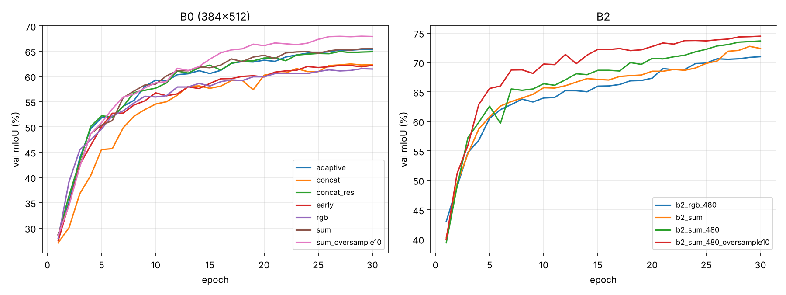

# 전체 실험 요약

11개 실험 전체를 한 번에 보는 폴더다. 실험 표(백본, 입력, 파라미터, val / test mIoU)는 [report.md](../report.md#2-전체-실험-결과)에 있다.
여기에는 학습 로그에서 만든 run 요약과 전체 학습 곡선이 있다. epoch는 모두 1부터 센 값이다.

- 학습 곡선은 B0 실험(384×512)과 B2 실험으로 나눠 그렸다.
- 모든 run이 30 epoch를 기록했고, epoch 20 이후에도 마지막까지 +1.2pp 이상 오르고 있다 ([run_convergence.csv](run_convergence.csv)).
  30 epoch는 수렴점이 아니라 모든 run에 같게 고정한 예산이다.

## 파일

| 파일 | 내용 |
|---|---|
| `run_summary.csv` | run별 융합, 백본, 입력 크기(높이, 너비), epoch, seed, target_fraction, best val mIoU, best epoch, 기록된 epoch 수, 마지막 epoch의 val mIoU |
| `run_convergence.csv` | run별 best epoch, 마지막 epoch가 best인지, epoch 10 / 20 / 마지막의 val mIoU, epoch 20 → 마지막 상승폭 |
| `curve_all_runs.png` | 전체 run의 epoch별 val mIoU 곡선 |

`run_summary.csv`, `run_convergence.csv`, `curve_all_runs.png`는 [tools/analyze_runs.py](../../tools/analyze_runs.py)가 `runs/*/log.jsonl`에서 만든다.
