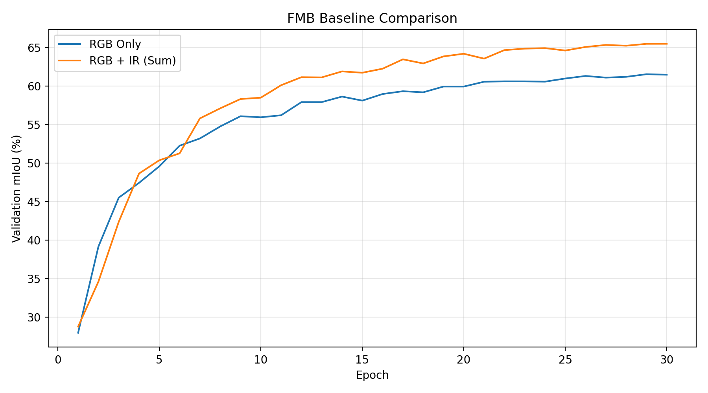
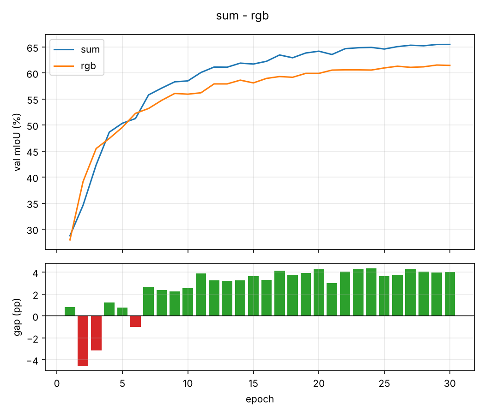
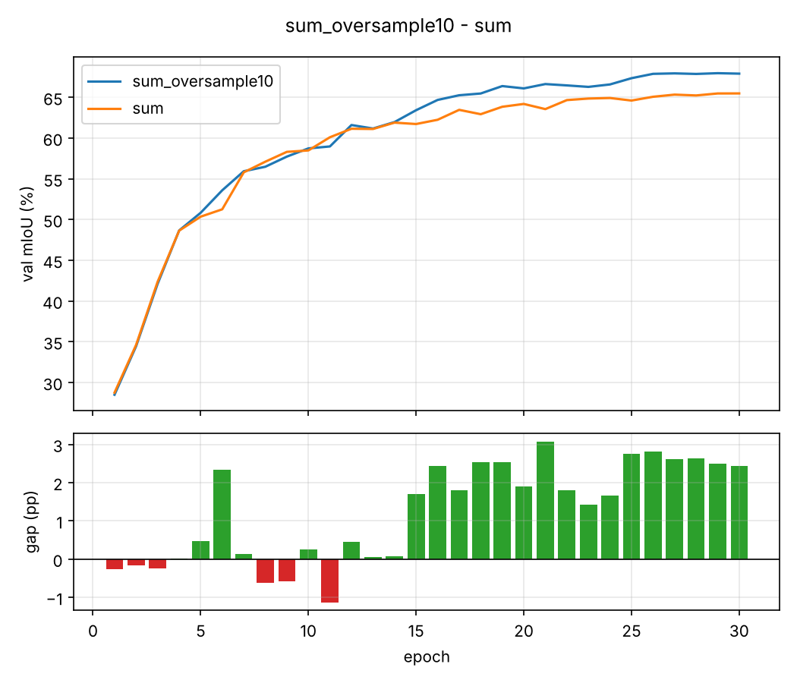

# 사이클 1. 기준선 재현과 희귀 클래스

확인한 것: IR이 RGB를 보완하는지(가설 1-A), 학습 데이터에 거의 없는 Bicycle을 oversampling으로 살릴 수 있는지(가설 1-B).
가설의 근거와 판정은 [설계 문서](../../docs/experiment_design.md#사이클-1-기준선과-희귀-클래스)에 있다.

## 실행 기록

데이터는 FMB(RGB + 열화상, 14 클래스, 무시 라벨 255)이고 train 1,000 / val 220 / test 280으로 나눈다.
제공된 분할 인덱스의 train과 val만 학습과 모델 선택에 썼고, test는 학습과 검증에 쓰지 않았다.

| 설정 | 값 |
|---|---|
| 백본 | MiT-B0 (두 인코더) |
| 입력 | 384×512 |
| epoch / batch | 30 / 8 |
| 옵티마이저 | AdamW, lr 6e-5, weight decay 0.01, warm-up 2 epoch |
| seed | 0 |
| 환경 | Google Colab, Tesla T4 |
| 평가 | val mIoU, best epoch의 체크포인트 |

세 run은 융합 방식 또는 샘플링만 다르고 나머지는 같다.

| # | 실험 | run | best epoch | val mIoU |
|---|---|---|---:|---:|
| 1 | RGB 단독 | `fmb_rgb` | 29 | 61.53 |
| 2 | RGB + IR (Sum) | `fmb_sum` | 30 | 65.48 |
| 3 | Sum + Class 12 Oversampling (10%) | `fmb_sum_oversample10` | 29 | 67.97 |

RGB 단독 → Sum은 +3.95pp, Sum → Oversampling은 +2.49pp다.
교수 제공 기준값(RGB 61.50, Sum 65.40)과 재현한 값(61.53, 65.48)이 거의 같다.
체크포인트(`best.pth`, `last.pth`)는 GitHub에 올리지 않고 팀 Google Drive `ICV_FMB/runs/`에 둔다.



epoch별 val mIoU 격차(Sum − RGB 단독)는 ep1 +0.79, ep2 −4.55, ep10 +2.55, ep20 +4.26, ep30 +4.02이고, ep2, 3, 6을 뺀 27개 epoch에서 양수다. 최대는 ep24의 +4.35다.
[run_gap_sum_vs_rgb.csv](run_gap_sum_vs_rgb.csv)

Oversampling − Sum은 ep1 −0.26, ep10 +0.25, ep20 +1.91, ep30 +2.43이고, 24개 epoch에서 양수다(음수는 ep1, 2, 3, 8, 9, 11). 최대는 ep21의 +3.08이다.
[run_gap_sum_oversample10_vs_sum.csv](run_gap_sum_oversample10_vs_sum.csv)





## 1-A. RGB 단독 vs Sum (클래스별)

[classiou_rgb_vs_sum.csv](classiou_rgb_vs_sum.csv), [classiou_rgb_vs_sum.png](classiou_rgb_vs_sum.png)

- 12개 클래스가 올랐고 Person(7)이 +19.26pp로 가장 크다.
- Bicycle(12)은 두 모델 모두 IoU 0이다.
- TrafficSign(4)은 0.39pp 내렸다.

융합은 전체 성능을 올리지만 모든 클래스를 올리지는 않는다.

## 1-B. 희귀 클래스 Bicycle(12)

**분포.** [dist_train_class.csv](dist_train_class.csv), [dist_class12_val_images.csv](dist_class12_val_images.csv)
- train 1,000장 중 10장에 있고 픽셀 비율은 0.00173%로 14개 클래스 중 최소다.
- val 220장 중 2장에 있고 합계 994픽셀이다 (183, 811).

**혼동.** [confusion_class7_12_rgb_vs_sum.csv](confusion_class7_12_rgb_vs_sum.csv), [confusion_rgb_vs_sum.png](confusion_rgb_vs_sum.png)
- 정답 Bicycle 픽셀을 RGB 단독은 43.46%, Sum은 68.41%를 Car(8)로 예측한다. 둘 다 Bicycle IoU는 0이다.
- 융합이 전체를 올려도 희귀 클래스 인식으로 이어지지는 않는다.

**Oversampling.**
- 방식: `WeightedRandomSampler`, 복원 추출. 목표 비율 10%.
- 대상: Bicycle이 들어 있는 train 이미지 10장(나머지 990장), 양성 가중치 11.0. 가중치는 train 라벨로만 만들고 val 라벨은 평가에만 쓴다.
- 모델과 손실은 그대로다 (B0, Sum, 7.04M).

| 지표 | Sum | Oversampling |
|---|---:|---:|
| Bicycle(12) IoU | 0.00 | 43.40 |
| 전체 mIoU | 65.48 | 67.97 |

Bicycle은 val 2장에만 있으므로 이 개선이 그 밖의 장면으로 일반화되는지는 이 결과만으로 말할 수 없다.
정성 비교: [qualitative_class12_gt.png](qualitative_class12_gt.png)(정답), [qualitative_class12_rgb_vs_sum.png](qualitative_class12_rgb_vs_sum.png)(예측 비교).

```bash
python train_oversample.py \
  --data_root data/FMB_prepared \
  --fusion sum \
  --backbone nvidia/mit-b0 \
  --epochs 30 \
  --seed 0 \
  --target_fraction 0.10 \
  --out runs/fmb_sum_oversample10

python predict.py \
  --data_root data/FMB_prepared \
  --ckpt runs/fmb_sum_oversample10/best.pth \
  --split test \
  --out submission
```

제출 파일 점검: test 예측 PNG 280장, 클래스 번호 0–13, zip 무결성과 파일명 통과.
갱신된 교수 코드로 val mIoU가 같게 재현되었다.

## 파일

| 파일 | 내용 |
|---|---|
| `classiou_rgb_vs_sum.csv`, `classiou_rgb_vs_sum.png` | RGB 단독 vs Sum 클래스별 IoU와 차이 |
| `confusion_rgb_vs_sum.png` | RGB 단독과 Sum의 혼동행렬 |
| `confusion_class7_12_rgb_vs_sum.csv` | Person(7), Bicycle(12)의 주요 오답 3개 |
| `dist_train_class.csv` | train의 클래스별 이미지 수, 픽셀 수, 비율 |
| `dist_class12_val_images.csv` | Bicycle이 들어 있는 val 이미지(인덱스, 픽셀 수, 라벨 크기) |
| `qualitative_class12_gt.png` | Bicycle 정답 시각화 |
| `qualitative_class12_rgb_vs_sum.png` | Bicycle 예측 비교 |
| `curve_rgb_vs_sum.png` | RGB 단독과 Sum의 val mIoU 곡선 |
| `run_gap_sum_vs_rgb.csv`, `curve_gap_sum_vs_rgb.png` | Sum − RGB 단독의 epoch별 val mIoU와 격차 |
| `run_gap_sum_oversample10_vs_sum.csv`, `curve_gap_sum_oversample10_vs_sum.png` | Oversampling − Sum의 epoch별 val mIoU와 격차 |
