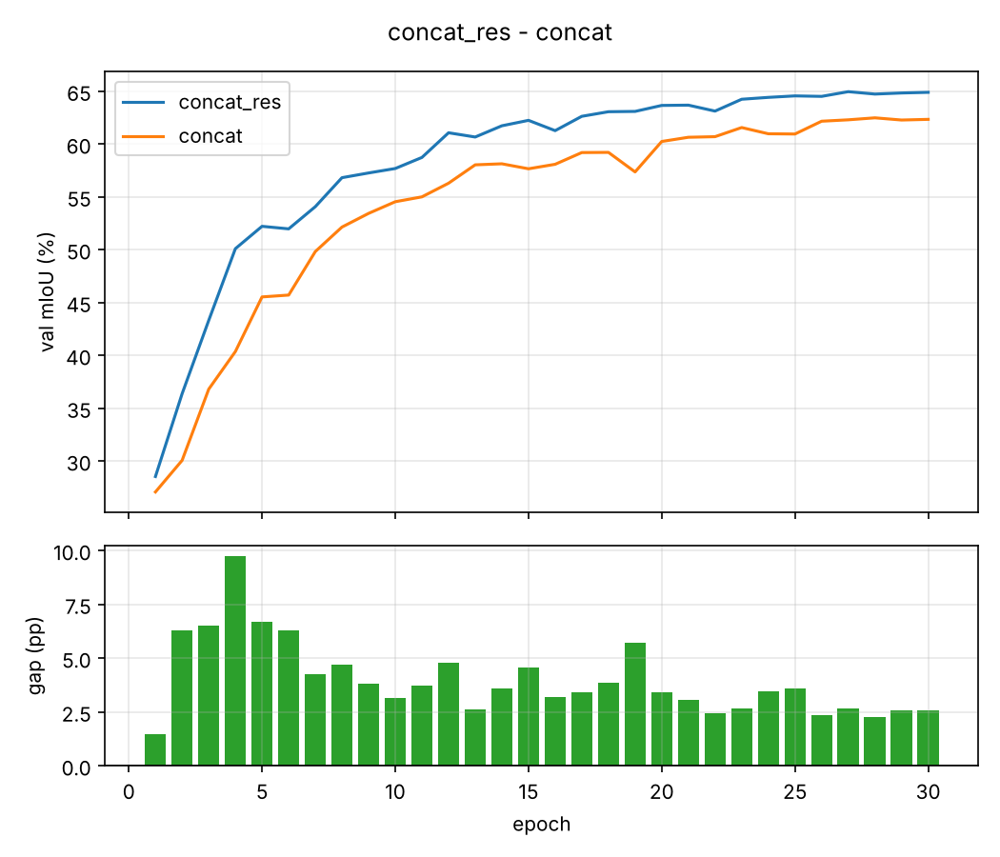
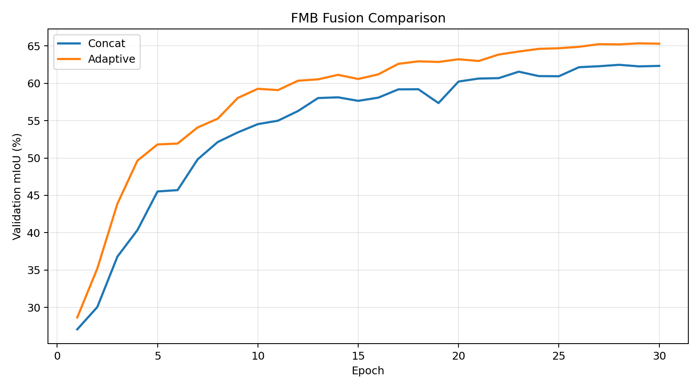

# 사이클 2. 융합 구조와 초기화

확인한 것: 학습형 융합이 고정 Sum보다 나은지(가설 2-A), Concat이 낮은 원인이 랜덤 초기화인지(가설 2-B), 입력 단계에서 합쳐도 되는지(가설 2-C).
근거와 판정은 [설계 문서](../../docs/experiment_design.md#사이클-2-융합-구조와-초기화)에 있다.

## 실행 기록

융합 모듈은 [fusion_seg/fusion.py](../../fusion_seg/fusion.py)에 있고 각 클래스에 출처가 적혀 있다.

| 융합 | 내용 | 실행 옵션 |
|---|---|---|
| Concat | 두 특징을 이어 붙인 뒤 1×1 conv로 채널을 줄인다 (랜덤 초기화) | `--fusion concat` |
| Adaptive | 채널별 게이트로 RGB와 IR을 섞는다. 게이트를 0으로 초기화해 시작 출력이 Sum과 같다 | `--fusion adaptive` |
| Concat_res | Sum에 concat 분기를 잔차로 더한다. 마지막 conv를 0으로 초기화해 시작 출력이 Sum과 같다 | `--fusion concat_res` |
| Early | 입력 단계에서 합치고 인코더는 하나만 쓴다 (제공 `model.py`) | `--fusion early` |

설정은 [사이클 1](../01_baseline/README.md)과 같다: B0, 384×512, 30 epoch, batch 8, lr 6e-5, weight decay 0.01, warm-up 2, seed 0, oversampling 없음.
checkpoint는 val mIoU가 가장 높은 epoch를 썼다.

| # | 융합 | run | Params | best epoch | val mIoU | Sum 대비 |
|---|---|---|---:|---:|---:|---:|
| 1 | RGB 단독 (참고) | `fmb_rgb` | 3.7M | 29 | 61.53 | −3.95 |
| 2 | Sum (기준) | `fmb_sum` | 7.04M | 30 | 65.48 | 0.00 |
| 4 | Concat | `fmb_concat` | 7.23M | 28 | 62.47 | −3.01 |
| 5 | Adaptive | `fmb_adaptive` | 7.23M | 29 | 65.35 | −0.13 |
| 6 | Concat_res | `fmb_concat_res` | 7.33M | 27 | 64.95 | −0.53 |
| 7 | Early | `fmb_early` | 3.72M | 30 | 62.19 | −3.29 |

Adaptive는 Concat보다 val이 2.88pp 높고, Sum과는 0.13pp 차이다. 모든 값은 seed 0 한 번의 결과다.
Early는 RGB 단독 대비 +0.66pp다.

리더보드(Codabench)에는 Adaptive만 올렸다.

| 모델 | test mIoU | Pixel accuracy | 누락 파일 | 제출 ID |
|---|---:|---:|---:|---|
| Adaptive (#5) | 55.84 | 91.95 | 0 | 1058499 |

Adaptive는 val mIoU가 가장 높은 checkpoint로 test 예측 280장을 만들어 제출했다. Concat, Concat_res, Early는 제출하지 않았다.

run 설정과 epoch별 로그: [Concat](../../runs/fmb_concat/), [Adaptive](../../runs/fmb_adaptive/), [Concat_res](../../runs/fmb_concat_res/), [Early](../../runs/fmb_early/).
`best.pth`, `last.pth`는 팀 Google Drive `ICV_FMB/runs/`에 있다.

## 학습 곡선과 epoch별 격차 (가설 2-B)

(Concat_res − Concat)의 격차는 ep4에서 +9.74로 최대이고, 구조가 다른 (Adaptive − Concat)도 ep4에서 +9.30으로 최대다.
이 파일들은 [tools/analyze_runs.py](../../tools/analyze_runs.py)가 `runs/`의 로그에서 만든다.

## 클래스별 IoU

Concat과 Adaptive를 같은 val에서 비교한 [classiou_concat_vs_adaptive.csv](classiou_concat_vs_adaptive.csv)에서 Adaptive는 Bicycle(0 대 0)을 제외한 13개 클래스 모두 Concat보다 높다.
차이가 큰 클래스는 Motorcycle(11) +7.37, Truck(9) +6.00이다.

## 파일

| 파일 | 내용 |
|---|---|
| `classiou_concat_vs_adaptive.csv` | Concat과 Adaptive의 클래스별 IoU와 차이 |
| `curve_concat_vs_adaptive.png` | Concat과 Adaptive의 val mIoU 곡선 |
| `run_gap_concat_res_vs_concat.csv`, `curve_gap_concat_res_vs_concat.png` | Concat_res − Concat의 epoch별 격차 |
| `run_gap_adaptive_vs_concat.csv`, `curve_gap_adaptive_vs_concat.png` | Adaptive − Concat의 epoch별 격차 |
