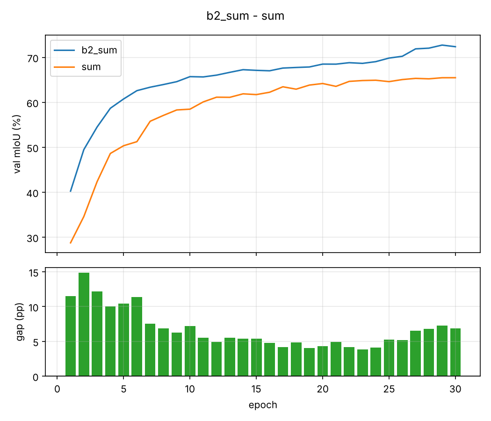
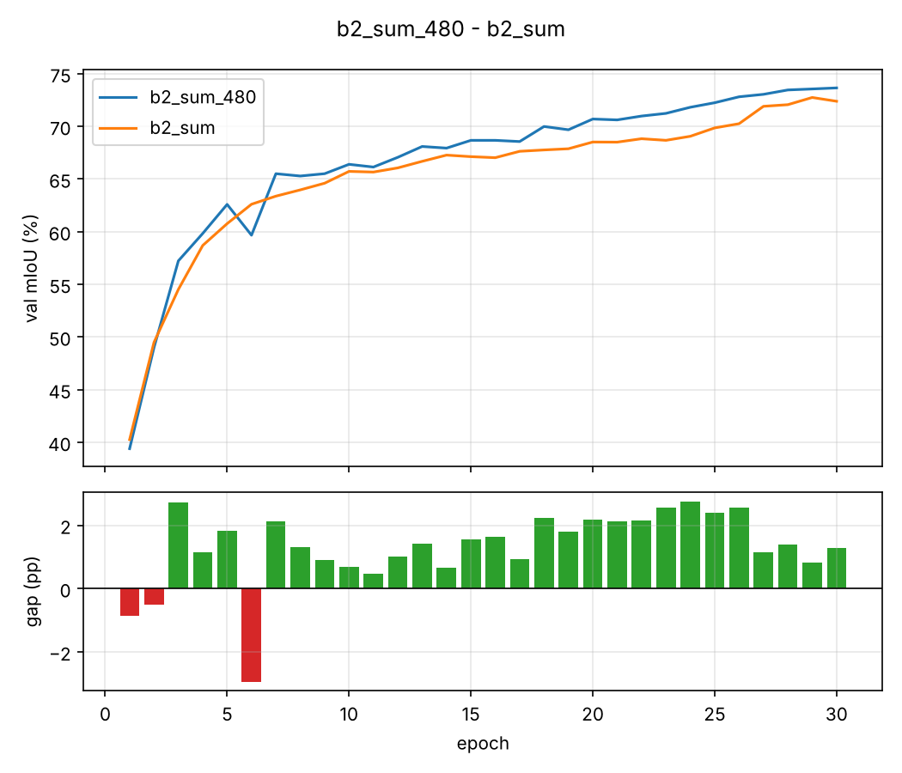

# 사이클 3. 백본 확대와 해상도

확인한 것: B0의 병목이 모델 용량인지(가설 3-A), 입력 축소가 작은 물체를 지우는지(가설 3-B).
근거와 판정은 [설계 문서](../../docs/experiment_design.md#사이클-3-용량과-해상도)에 있다.

## 실행 기록

융합은 Sum으로 고정하고 두 인코더의 백본과 입력 크기만 바꿨다.
백본은 두 인코더 모두 ImageNet 사전학습 `nvidia/mit-b2`이고 총 파라미터는 51.55M이다 (규칙 상한 약 52M).
파라미터 수는 입력 해상도와 무관하다. 나머지 설정은 [사이클 1](../01_baseline/README.md)과 같다 (batch 8, lr 6e-5, weight decay 0.01, warm-up 2, 30 epoch, seed 0, Colab T4).

| # | 실험 | run | 입력 | Params | best epoch | val mIoU | test mIoU |
|---|---|---|---|---:|---:|---:|---:|
| 2 | Sum, MiT-B0 | `fmb_sum` | 384×512 | 7.04M | 30 | 65.48 | |
| 5 | Adaptive, MiT-B0 | `fmb_adaptive` | 384×512 | 7.23M | 29 | 65.35 | 55.84 |
| 8 | Sum, MiT-B2 | `fmb_b2_sum` | 384×512 | 51.55M | 29 | 72.74 | 63.90 |
| **9** | **Sum, MiT-B2 (최종)** | `fmb_b2_sum_480` | 480×640 | 51.55M | 30 | **73.65** | **66.13** |

- 백본 B0 → B2 (#2 → #8): val +7.26pp. test(제출 1060429)는 Adaptive(B0)보다 +8.06pp, 교수 제공 Sum 기준(56.30)보다 +7.60pp 높다.
  #8은 한 epoch에 약 2.0분, 전체 61.6분이 걸렸다.
- 해상도 384×512 → 480×640 (#8 → #9): val +0.91pp, test +2.23pp (제출 1061666). 480×640은 원본 600×800의 0.8배다.
- 백본을 키운 격차가 융합 방식을 바꾼 격차(Concat, Adaptive 대비 Sum: −3.01, −0.13pp)보다 훨씬 크다.
- val과 test의 격차는 #5가 9.51pp, #8이 8.84pp, #9가 7.52pp다. B0와 B2 run 모두 val 순서가 test 순서와 같다.
- best epoch는 1부터 센 값이다 (`log.jsonl`의 epoch 28 → 29). 두 제출에 TTA는 쓰지 않았다.
- 분할은 원본 `tools/prepare_fmb.py` 출력과 train 1,000 / val 220 / test 280 파일 이름이 같음을 확인했다.

재현:

```bash
python train.py --data_root data/FMB_prepared --fusion sum \
  --backbone nvidia/mit-b2 --epochs 30 --seed 0 --out runs/fmb_b2_sum
python predict.py --data_root data/FMB_prepared \
  --ckpt runs/fmb_b2_sum/best.pth --split test --out submission_b2_sum

python train.py --data_root data/FMB_prepared --fusion sum --backbone nvidia/mit-b2 \
  --height 480 --width 640 --epochs 30 --seed 0 --out runs/fmb_b2_sum_480
```

run 설정과 epoch별 로그: [`runs/fmb_b2_sum/`](../../runs/fmb_b2_sum/), [`runs/fmb_b2_sum_480/`](../../runs/fmb_b2_sum_480/).
`best.pth`, `last.pth`는 팀 Google Drive `ICV_FMB/runs/`에 있다. #9는 Colab 연결이 끊겨 같은 명령을 다시 실행해 `last.pth`에서 재개했다.

## 클래스별 변화

- B0 → B2 ([classiou_b0_vs_b2.csv](classiou_b0_vs_b2.csv)): 14개 클래스가 모두 올랐다. Bicycle +39.83, TrafficLight +10.21, Motorcycle +9.35, Bus +7.65이고 Sky +0.45, Road +1.31이다.
- 384×512 → 480×640 ([classiou_384_vs_480.csv](classiou_384_vs_480.csv)): Bicycle +6.77, Pole +3.43, Person +2.02, TrafficLight +1.32가 오르고 Bus −3.33, Truck −0.27이 내렸다. Road, Sky, Building은 ±0.2 이내다.
- B0 Sum 대비 B2 Sum(384×512)의 epoch별 격차는 ep1 +11.50, ep2 +14.89(최대), ep10 +7.24, ep20 +4.32, ep30 +6.90이고, 30 epoch 내내 양수다(최소 ep23의 +3.82). [run_gap_b2_sum_vs_sum.csv](run_gap_b2_sum_vs_sum.csv)
- epoch별로 본 480×640 − 384×512 격차는 [run_gap_b2_sum_480_vs_b2_sum.csv](run_gap_b2_sum_480_vs_b2_sum.csv)에 있다 (ep24 +2.75, 마지막 +1.27, ep1, 2, 6에서는 음수다).





## 파일

| 파일 | 내용 |
|---|---|
| `classiou_b0_vs_b2.csv` | B0 RGB / Sum / Concat / Adaptive와 B2 Sum 384×512의 클래스별 IoU, B2 − B0 Sum 차이 |
| `classiou_384_vs_480.csv` | B2 Sum의 384×512와 480×640 클래스별 IoU, 차이 (`480_minus_384`). 480×640이 최종 모델 |
| `run_gap_b2_sum_vs_sum.csv`, `curve_gap_b2_sum_vs_sum.png` | B2 Sum 384×512 − B0 Sum의 epoch별 격차 |
| `run_gap_b2_sum_480_vs_b2_sum.csv`, `curve_gap_b2_sum_480_vs_b2_sum.png` | 480×640 − 384×512의 epoch별 격차 |
