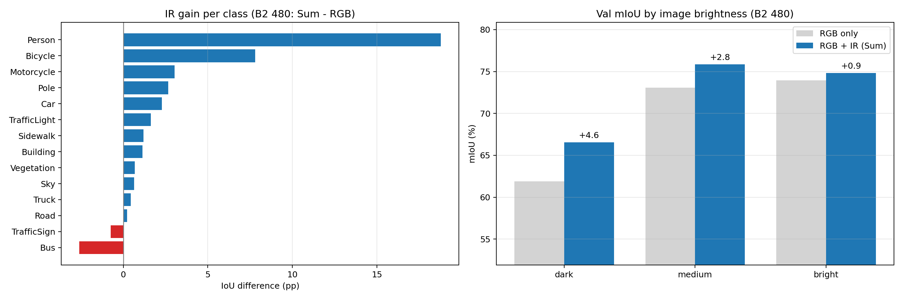
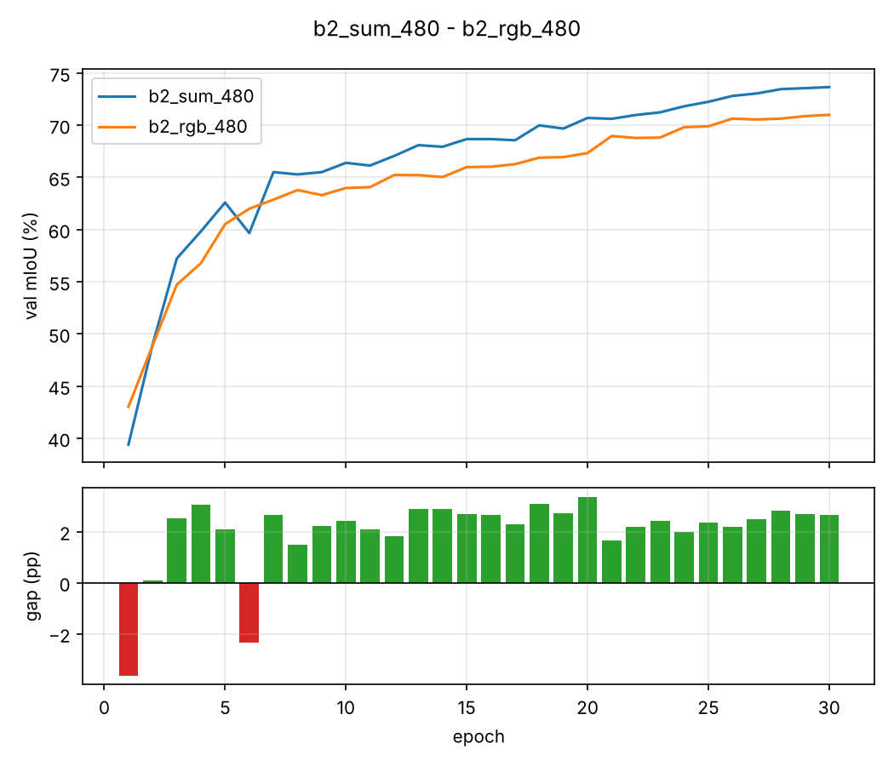

# 사이클 4. 최종 설정에서 IR 기여 분리

확인한 것: 최종 설정(B2, 480×640)에서도 IR이 기여하는지, 그 기여가 어두운 장면일수록 큰지.
근거와 판정은 [설계 문서](../../docs/experiment_design.md#사이클-4-최종-설정에서-ir-기여-분리)에 있다.

## 실행 기록

B2, 480×640, 나머지 설정은 [사이클 1](../01_baseline/README.md)과 같고 융합만 다르다.

| # | 실험 | run | Params | best epoch | val mIoU |
|---|---|---|---:|---:|---:|
| 10 | RGB 단독 | `fmb_b2_rgb_480` | 27.36M | 30 | 70.99 |
| 9 | RGB + IR (Sum, 최종) | `fmb_b2_sum_480` | 51.55M | 30 | 73.65 |

IR 기여는 전체 +2.66pp다 (B0에서는 +3.95pp).
Sum은 RGB 단독보다 인코더가 하나 더 있어 파라미터가 함께 늘어난다. 이 차이는 한계로 [설계 문서](../../docs/experiment_design.md#측정-한계)에 적었다.

run 설정과 epoch별 로그: [`runs/fmb_b2_rgb_480/`](../../runs/fmb_b2_rgb_480/), [`runs/fmb_b2_sum_480/`](../../runs/fmb_b2_sum_480/).

## 밝기별 IR 기여

val 220장을 RGB 이미지 평균 밝기(0–255)로 정렬해 73 / 73 / 74장으로 3등분했다. 낮/밤이나 날씨 라벨이 아니라 이미지 밝기 기준이다.
[miou_brightness_rgb_vs_sum.csv](miou_brightness_rgb_vs_sum.csv)

| 밝기 그룹 | 이미지 | RGB 단독 | RGB + IR | IR 기여 |
|---|---:|---:|---:|---:|
| 어두움 (39–98) | 73 | 61.91 | 66.55 | **+4.64** |
| 중간 (98–149) | 73 | 73.06 | 75.86 | +2.80 |
| 밝음 (149–162) | 74 | 73.94 | 74.83 | +0.89 |

## 클래스별 IR 기여

[classiou_rgb_vs_sum.csv](classiou_rgb_vs_sum.csv), [classiou_ir_gain_brightness.png](classiou_ir_gain_brightness.png)

- 큰 순서: Person **+18.79**, Bicycle +7.81, Motorcycle +3.04, Pole +2.66, Car +2.27.
- 내린 클래스: TrafficSign −0.75, Bus −2.60.
- 어두운 그룹만 보면 Person이 42.32 → 65.82 (+23.50)다. Bicycle은 이 그룹에 이미지가 없다. [classiou_dark_rgb_vs_sum.csv](classiou_dark_rgb_vs_sum.csv)
- 정성 비교(IR 효과가 가장 컸던 어두운 val 3장): [qualitative_dark_rgb_vs_sum.png](qualitative_dark_rgb_vs_sum.png)

## epoch별 IR 기여

(Sum − RGB 단독)의 epoch별 격차는 ep1 −3.63, ep5 +2.07, ep10 +2.41, ep20 +3.36, ep30 +2.66이다.
[run_gap_b2_sum_480_vs_b2_rgb_480.csv](run_gap_b2_sum_480_vs_b2_rgb_480.csv)

## 파일

| 파일 | 내용 |
|---|---|
| `classiou_rgb_vs_sum.csv` | B2 480 RGB 단독과 Sum의 클래스별 IoU, 클래스별 IR 기여 |
| `classiou_dark_rgb_vs_sum.csv` | 어두운 그룹만의 클래스별 IoU. Bicycle은 이 그룹에 없어 비어 있다 |
| `miou_brightness_rgb_vs_sum.csv` | 밝기 그룹별 mIoU (RGB 단독 / Sum / Sum + 좌우 반전)와 IR 기여 |
| `classiou_ir_gain_brightness.png` | 왼쪽: 클래스별 IR 기여, 오른쪽: 밝기 그룹별 mIoU |
| `qualitative_dark_rgb_vs_sum.png` | 어두운 val 장면 3장의 RGB, IR, 정답, RGB 단독 예측, RGB + IR 예측 |
| `run_gap_b2_sum_480_vs_b2_rgb_480.csv`, `curve_gap_b2_sum_480_vs_b2_rgb_480.png` | Sum − RGB 단독의 epoch별 격차 |
