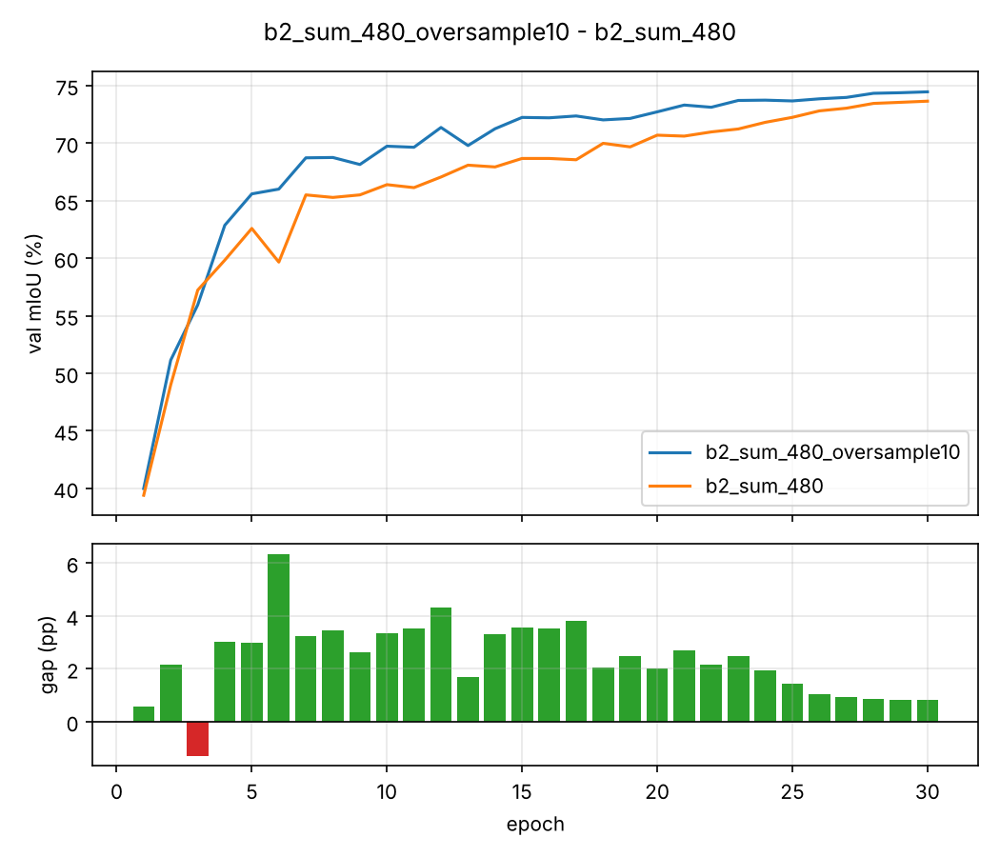

# 사이클 5. 최종 설정에서 샘플링, val과 test의 역전

확인한 것: 사이클 1에서 B0에 효과가 있던 Bicycle oversampling이 최종 설정(B2, 480×640)에서도 val과 test를 함께 올리는지.
근거와 판정은 [설계 문서](../../docs/experiment_design.md#사이클-5-최종-설정에서-샘플링)에 있다.

## 실행 기록

#9(B2 Sum, 480×640)와 같은 설정에 [사이클 1-B](../01_baseline/README.md#1-b-희귀-클래스-bicycle12)와 같은 oversampling(Bicycle 포함 train 10장, 목표 비율 10%)만 더했다.

| # | 실험 | run | Params | best epoch | val mIoU | test mIoU |
|---|---|---|---:|---:|---:|---:|
| 9 | Sum (최종) | `fmb_b2_sum_480` | 51.55M | 30 | 73.65 | 66.13 |
| 11 | Sum + Oversampling | `fmb_b2_sum_480_oversample10` | 51.55M | 30 | 74.46 | 65.64 |

리더보드 제출 ID는 1062714다.

```bash
python train_oversample.py --data_root data/FMB_prepared --fusion sum \
  --backbone nvidia/mit-b2 --height 480 --width 640 --epochs 30 --seed 0 \
  --target_fraction 0.10 --out runs/fmb_b2_sum_480_oversample10
```

## val은 올랐고 test는 내렸다

| | val | test | val − test |
|---|---:|---:|---:|
| #9 | 73.65 | 66.13 | 7.52 |
| #11 | 74.46 | 65.64 | 8.82 |
| 차이 | **+0.81** | **−0.49** | +1.30 |

### 원인 분해 (val)

val 상승 +0.81 중 Bicycle 한 클래스의 기여가 +1.14이고, 나머지 13개 클래스 합계는 −0.33이다.

| 클래스 | #9 | #11 | 차이 |
|---|---:|---:|---:|
| Bicycle | 46.60 | 62.59 | **+15.98** |
| Sidewalk | 57.04 | 57.61 | +0.57 |
| Bus | 73.72 | 74.25 | +0.53 |
| Road | 90.29 | 90.70 | +0.40 |
| Person | 67.16 | 66.58 | −0.58 |
| Truck | 65.58 | 64.20 | −1.38 |
| Motorcycle | 64.15 | 62.46 | −1.69 |
| TrafficSign | 76.24 | 74.15 | −2.10 |

Bicycle 외에 8개 클래스가 내렸고(Vegetation −0.01, Building −0.08처럼 0에 가까운 것 포함), 위 표에는 그중 4개만 실었다. 14개 클래스 전체는 [classiou_sum_vs_oversample.csv](classiou_sum_vs_oversample.csv)에 있다.

### 교차 확인

Bicycle을 뺀 val 13개 클래스의 평균 mIoU는 75.73 → 75.37 (−0.36)이다 (각각 (14 × 전체 mIoU − Bicycle IoU) ÷ 13).
test −0.49와 방향과 크기가 비슷하다. val 안에서 이미 Bicycle 외 클래스는 오르지 않았다는 뜻이다.

Bicycle은 val에서 2장뿐이라 이 클래스의 IoU는 변동이 크다 ([dist_class12_val_images.csv](../01_baseline/dist_class12_val_images.csv)).
test −0.49는 0.5pp 이내라 단독으로는 순위를 말할 수 없고, 위의 val 분해와 방향이 같다는 점에서 의미를 둔다.

### epoch별 격차

#11 − #9의 val mIoU는 epoch 3(−1.28)을 뺀 29개 epoch에서 양수다. 최대는 epoch 6의 +6.34이고, ep10 +3.34, ep20 +2.03을 지나 ep30에서 +0.81이 된다. 두 run 모두 best epoch가 30이다.
격차는 학습이 진행되며 줄고, 마지막 +0.81은 위 분해에서 Bicycle 기여(+1.14)와 나머지 13개 클래스(−0.33)로 나뉜다.
[run_gap_b2_sum_480_oversample10_vs_b2_sum_480.csv](run_gap_b2_sum_480_oversample10_vs_b2_sum_480.csv)



## 파일

| 파일 | 내용 |
|---|---|
| `classiou_sum_vs_oversample.csv` | #9(Sum)와 #11(Sum + Oversampling)의 클래스별 val IoU와 차이 |
| `run_gap_b2_sum_480_oversample10_vs_b2_sum_480.csv`, `curve_gap_b2_sum_480_oversample10_vs_b2_sum_480.png` | #11 − #9의 epoch별 val mIoU와 격차 |
