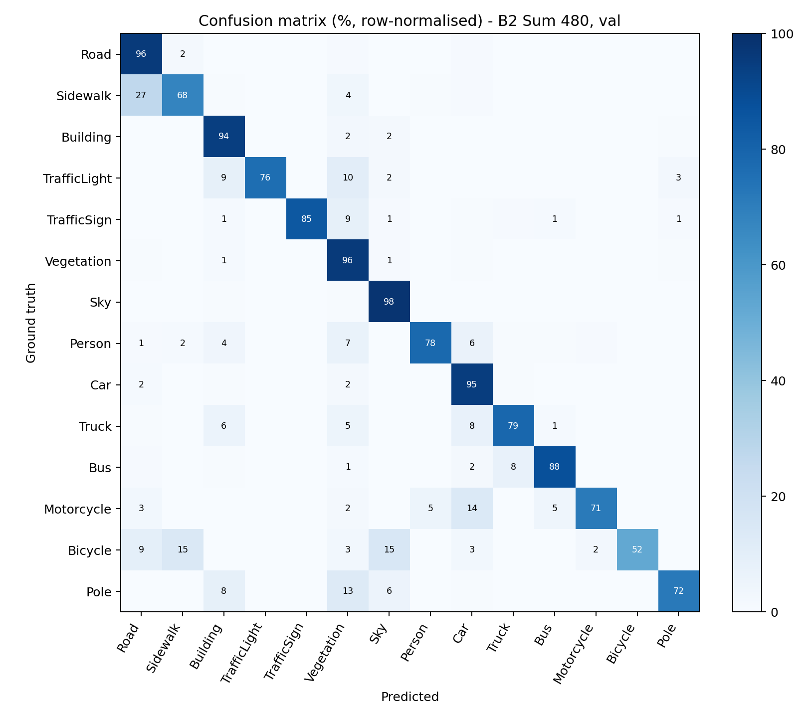
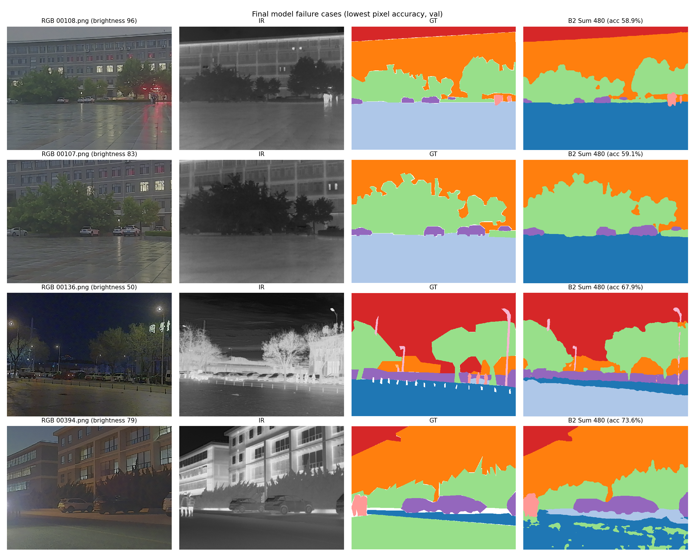

# 최종 모델 분석

사이클이 아니라 최종 모델(#9: B2, Sum, 480×640, 51.55M, val 73.65 / test 66.13, 제출 1061666)의 오류를 분석한 폴더다.
[사이클 4](../04_ir_contribution/README.md)에서 정한 구성을 val 220장에서 본다. test 라벨은 쓰지 않았다.

## 혼동

행 정규화 혼동행렬(각 정답 클래스 픽셀 중 예측 비율, %): [confusion_final.png](confusion_final.png)

IoU가 가장 낮은 6개 클래스와 각 클래스가 가장 많이 잘못 예측된 클래스: [confusion_final_top.csv](confusion_final_top.csv)

| 클래스 | IoU | 오답 1 | 오답 2 | 오답 3 |
|---|---:|---|---|---|
| 12 Bicycle | 46.60 | Sky 15.5% | Sidewalk 14.7% | Road 9.3% |
| 1 Sidewalk | 57.04 | Road 26.6% | Vegetation 3.8% | Car 1.0% |
| 13 Pole | 60.72 | Vegetation 12.6% | Building 8.5% | Sky 5.8% |
| 3 TrafficLight | 63.10 | Vegetation 10.4% | Building 8.5% | Pole 2.5% |
| 11 Motorcycle | 64.15 | Car 14.0% | Person 5.2% | Bus 4.5% |
| 9 Truck | 65.58 | Car 7.6% | Building 5.9% | Vegetation 5.4% |

## 실패 사례

픽셀 정확도가 가장 낮은 val 4장이다. 384×512 모델(#8)에서도 같은 4장이었고, 오류는 대부분 노면 재질 혼동이다.
[failure_final.csv](failure_final.csv), [failure_final.png](failure_final.png)(RGB, IR, 정답, 예측)

| 이미지 | 장면 | 픽셀 정확도 | 주된 오류 (정답 → 예측) | 오류 중 비율 |
|---|---|---:|---|---:|
| 00108 | 비에 젖은 광장, 주간 | 58.9% | Sidewalk → Road | 93.0% |
| 00107 | 비에 젖은 광장, 주간 | 59.1% | Sidewalk → Road | 94.7% |
| 00136 | 야간, 가로등 | 67.9% | Road → Sidewalk | 72.6% |
| 00394 | 야간, 전조등 눈부심 | 73.6% | Vegetation → Road | 78.9% |

젖은 노면의 반사와 야간 조명 때문에 RGB가 흔들리고, IR에서는 온도가 비슷한 보도, 차도, 잔디가 하나의 면으로 보이는 것으로 해석한다.
센서 융합과 모델 확장으로도 풀리지 않은 오류다.

## TTA

좌우 반전 평균(TTA)을 val에서 비교했다. [miou_tta.csv](miou_tta.csv)

| 모델 | val mIoU |
|---|---:|
| B2 RGB 480 | 70.99 |
| B2 Sum 480 | 73.65 |
| B2 Sum 480 + flip | 73.63 |

TTA는 효과가 없어(−0.02) 제출에 쓰지 않았다.

## 파일

| 파일 | 내용 |
|---|---|
| `confusion_final.png` | 최종 모델의 행 정규화 혼동행렬 |
| `confusion_final_top.csv` | IoU 최저 6개 클래스와 클래스별 주된 오답 3개 |
| `failure_final.csv`, `failure_final.png` | 픽셀 정확도 최저 val 4장과 각 이미지의 주된 오류, 같은 4장의 RGB, IR, 정답, 예측 |
| `miou_tta.csv` | B2 RGB 480, B2 Sum 480, B2 Sum 480 + flip의 val mIoU |

최종 모델의 클래스별 IoU와 384×512 대비 차이는 [03_capacity/classiou_384_vs_480.csv](../03_capacity/classiou_384_vs_480.csv)에 있다.
