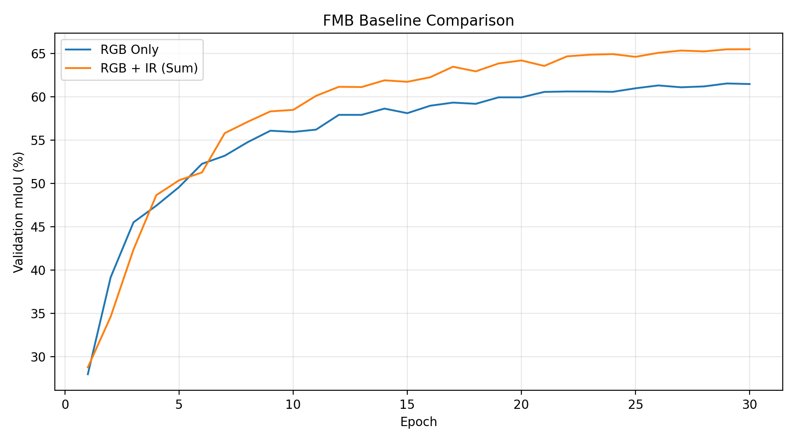

# FMB Baseline Experiment Results

## 1. Experiment Overview

This document summarizes the baseline experiments for the ICV final project, Track A: FMB RGB-Infrared Semantic Segmentation.

The objective is to reproduce the provided baseline and evaluate the contribution of infrared information to semantic segmentation performance.

## 2. Dataset

- Dataset: FMB
- Task: RGB-Infrared Semantic Segmentation
- Number of classes: 14
- Training images: 1,000
- Validation images: 220
- Test images: 280
- Ignore label: 255

The provided train/validation indices were used for training and model selection. Test data was excluded from training and validation.

## 3. Experimental Settings

| Parameter | Setting |
|---|---|
| Backbone | MiT-B0 |
| Input Resolution | 384 × 512 |
| Epochs | 30 |
| Batch Size | 8 |
| Learning Rate | 0.00006 |
| Optimizer | AdamW |
| Random Seed | 0 |
| Environment | Google Colab, Tesla T4 |
| Evaluation Metric | Validation mIoU |

Both models were trained under the same experimental settings, with only the fusion configuration changed.

## 4. Baseline Results

| Model | Best Epoch | Validation mIoU (%) |
|---|---:|---:|
| RGB Only | 29 | 61.53 |
| RGB + IR (Sum Fusion) | 30 | **65.48** |

**Performance improvement:**

65.48 - 61.53 = **+3.95 percentage points**

### Comparison with Instructor Baseline

| Model | Instructor Baseline | Reproduced Result |
|---|---:|---:|
| RGB Only | 61.50 | 61.53 |
| RGB + IR (Sum Fusion) | 65.40 | 65.48 |

The reproduced results closely match the instructor-provided baseline values.

## 5. Training Curves



The graph illustrates validation mIoU over 30 epochs for both models.

RGB + IR Sum Fusion achieves higher final validation mIoU than RGB Only.

## 6. Analysis

- RGB Only achieved a best validation mIoU of 61.53%.
- RGB + IR Sum Fusion achieved a best validation mIoU of 65.48%.
- Adding infrared information improved validation mIoU by 3.95 percentage points.
- The results confirm the benefit of multimodal fusion under the evaluated validation setting.
- Further experiments are needed to determine whether alternative fusion methods can improve performance.

## 7. Checkpoints and Logs

Training outputs are stored separately in Google Drive.

```text
ICV_FMB/runs/
├── fmb_rgb/
│   ├── best.pth
│   ├── last.pth
│   ├── args.json
│   └── log.jsonl
├── fmb_sum/
│   ├── best.pth
│   ├── last.pth
│   ├── args.json
│   └── log.jsonl
└── baseline_val_miou.png
```

Model checkpoints and datasets are not included in the GitHub repository.

## 8. Future Work

The next experiments will focus on improving RGB-Infrared fusion performance.

- Implement Concat Fusion.
- Evaluate Adaptive Fusion.
- Compare alternative fusion methods under controlled settings.
- Analyze performance improvements and conduct ablation studies.

All improvements will be compared against the reproduced RGB Only and Sum Fusion baselines.
